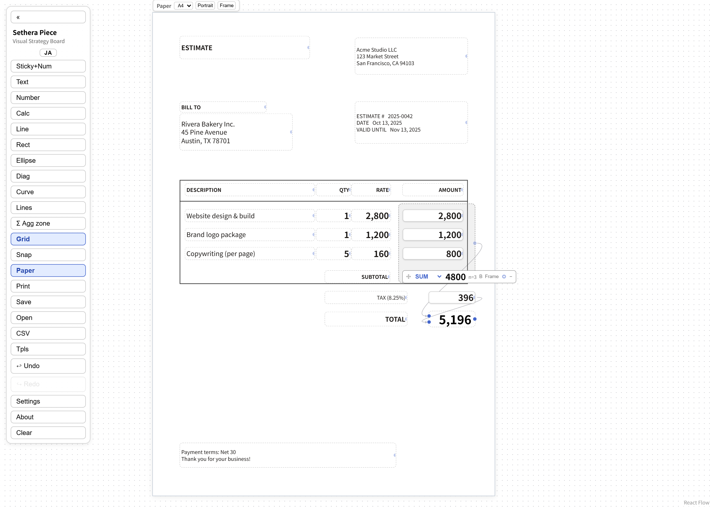

# Sethera Piece（セセラピース）

日本語: [README.ja.md](README.ja.md)

A calculation board without cells. Place free-form text and number
"pieces" anywhere, and build subtotals, sales tax and totals with
aggregation zones and calc pieces — a visual board for estimates
and summary tables.

> Count by enclosing — the spreadsheet that thinks like a whiteboard.



**[Live demo](https://cuculhart.github.io/sethera-piece/)** — runs in your browser, no install

See [CHANGELOG](CHANGELOG.md) for the release history (latest: v1.0.0).

## Features

- **Pieces** — text / number / sticky-note + number. Multi-line input, alignment, fill & text colors, sizes (S/M/L/LL), bold, borderless display
- **Calc pieces** — ＋−×÷ with rounding (ceil / floor / round). Operands connect by wires; unconnected ports take constants. Compact result-only and frameless display
- **Aggregation zones (Σ)** — live-aggregate enclosed pieces with Sum / Count / Avg / Max / Min. Updates instantly as pieces move in and out. Zone results feed calc pieces. Pieces partially overlapping a zone are flagged with a red dashed warning. The pane's "Filter" restricts aggregation to one piece color — SumIf/CountIf style category totals across the 8 piece colors
- **Lines** — horizontal/vertical rules and rectangle frames for tables (thin / bold / extra bold / dashed / dotted / dash-dot / double, front/back, fill). Grid snapping makes adjacent rect edges overlap exactly. Arrow and ● end caps on both ends
- **Ellipse, arc, curve, diagonal** — "Ellipse" draws circles and ellipses (w=h for a perfect circle, fill and double-line supported). The pane's "Shape" toggles rect ↔ ellipse ↔ arc (arcs take start/end angles in degrees; direction is switchable between CAD-style CCW and SVG-style; fill renders a sector). "Curve" is a click-vertex spline through all points; drag vertices to deform, double-click to add/remove. "Diagonal" is a frame diagonal (╲╱). All support arrow/● caps — compose them into flowchart diamonds and connectors
- **Custom pieces (groups)** — group rects, text, numbers and calcs into a reusable unit that moves as one. Keep templates off-paper and copy & paste them onto the sheet (copies are independent). Alt+drag adjusts individual members
- **Template library** — the "Tpls" modal stores named selections; "Insert" places them in other documents (kept in localStorage, separate from documents). Rename, delete, and JSON export/import supported
- **Lock** — pin pieces, calcs and lines from the pane. Locked items cannot move, resize, be deleted or edited, and are excluded from group motion and alignment (amber dashed frame; never printed)
- **Property pane** — edit piece, line, curve, calc and zone attributes on the right; multi-select applies changes in batch. "Array" duplicates a selection by count and dx/dy offsets
- **Number formats** — thousands separators, fixed decimals (auto/0–3), hide-zero, numeric weight (thin/normal/bold), and negative styles (−, (), ▲, red, red−) on numbers, calc results and aggregates
- **Fonts** — set the document-wide font in Settings (Gothic = Noto Sans JP / Mincho = Shippori Mincho / BIZ UDP Gothic / monospace / custom font name). Per-piece overrides, applied in batch via multi-select. All bundled fonts work offline
- **Multilingual UI** — switch the UI language between Japanese and English in Settings (auto-detects from the browser language; non-Japanese falls back to English)
- **Paper & print** — A4/B5/A3 portrait/landscape frame; the frame is captured for print/PDF (wiring is not printed)
- **JSON save/load** — export the whole document as a file, handy for reusing estimate templates
- **CSV/TSV** — the "CSV" panel round-trips with Excel. Import pastes a copied range or reads a file (auto-detects UTF-8, UTF-16, Shift_JIS, EUC-JP); numeric columns become number pieces and are instantly aggregatable. Export rebuilds rows/columns from the layout plus computed values — TSV copy or UTF-8-BOM CSV save
- **Undo / Redo** — Ctrl+Z / Ctrl+Shift+Z (100 steps)
- **Line-edit mode** — brings only lines to the front so they are easy to grab
- **Snap & guides** — while dragging/resizing, pieces snap to edges, midpoints and centers of other nodes and the paper frame, showing guide lines. A HUD reads out coordinates while dragging and w×h while resizing (neither is printed)
- **Settings** — "⚙ Settings" changes toolbar color and theme (standard / Quiet / dark). The paper can also show as a transparent dashed frame
- **Fully local** — data lives only in localStorage and JSON files; nothing is sent anywhere

## Getting started

```bash
npm install
npm run dev      # http://localhost:5173/sethera-piece/
npm run build    # production build → app/dist/
npm run typecheck
```

React 19 + TypeScript + Vite + [Kimetron Isle](https://github.com/cuculhart/kimetron) (vendored in `kimetron/`) + html-to-image.

## Basic usage

| Goal | How |
|---|---|
| Add a piece | "Text", "Number" or "Sticky+Num" on the toolbar |
| Edit | Double-click (Enter = newline, Ctrl+Enter or click outside = apply), or select and edit in the property pane |
| Batch attributes | Select multiple pieces → apply color, alignment, size, bold etc. in the pane |
| Align | Multi-select → pane "Align" for left/right/top/bottom, width and height |
| Resize | Drag an edge, or use pane "Size" −/＋ (±12) or type a value |
| Group resize | Multi-select and drag an edge — the same edge follows on all (line endpoints follow too; vertical⇔horizontal flips together) |
| Fit to cell | Select pieces inside a rectangle line → pane "Rect: Fit" matches position and size |
| Calculate | "Calc" → drag a wire from the ● on a piece's right edge to A/B on the calc's left; unconnected ports take constants |
| Subtotal | Select pieces and hit "Σ Agg zone", or press "Σ" and drag a range |
| Tax & total | Wire from a zone's right ● to a calc piece (×0.1 floor = sales tax; net + tax = gross) |
| Color-conditional aggregation | Multi-select target pieces and give them one color → select the zone → pick that color in pane "Filter" (only pieces of that color are aggregated) |
| Lines | "Line" → resize for horizontal/vertical. "Rect" for a 4-sided frame. Turn on "Lines" mode to grab lines under pieces. Pane sets line style (thin/bold/xbold/dash/dot/chain/double) and arrow/● caps |
| Circle, ellipse, arc | "Ellipse" → resize (w=h for a circle). Pane "Shape" switches rect ↔ ellipse ↔ arc; arcs take start/end angles in degrees (0° = 3 o'clock; "CCW" on = CAD-style, off = SVG-style) |
| Curve | "Curve" → click vertices (3+) → re-click the last point or Enter to finish (Esc = cancel). While selected, drag vertices to deform; double-click a vertex to delete; double-click the line to add one |
| Diagonal | "Diag" → frame diagonal (╲). Pane "Diag" toggles ╲╱; "None" returns to a normal line. Arrow/● caps allowed (works as a flowchart connector) |
| Array duplicate | Select → pane "Array" sets count and dx/dy offsets → "Dup" (repeat detail rows, etc.) |
| Nudge | Arrow keys move one grid step (12px); Shift+arrow = 1px (groups move together; locked items are excluded) |
| Lock | Select → pane "Lock". Locked items cannot move, be edited or deleted; "Release" restores |
| Duplicate | Ctrl+C / Ctrl+V / Ctrl+D (copying a group member duplicates the whole group) |
| Group / ungroup | Multi-select → pane "Group" → "Group". Alt+drag moves a member individually |
| Templates | Select → "Tpls" → name and save. "Insert" from the list places it at the viewport center; JSON export/import is also available |
| Undo / redo | Ctrl+Z / Ctrl+Shift+Z (or Ctrl+Y) |
| Print | "Print" or Ctrl+P (prints the paper frame; the whole board if no paper) |
| Save / load | "Save" downloads JSON; "Open" restores |
| CSV import | "CSV" → "Import": paste a range copied from Excel or choose a file; check column types (text/number/ignore) and the header row, then import |
| CSV export | "CSV" → "Export": copy TSV from the selection/whole document (paste directly into Excel) or save CSV (calcs export their results) |

### Estimate workflow example

```text
qty × unit price → line amount (calc)
enclose line rows in a zone → net subtotal (Σ)
zone × 0.1 (floor) → sales tax (calc)
subtotal + tax → total (calc)
```

Draw the table frame with lines, drop pieces into the cells, and
keep calc pieces "compact + frameless" to sit inside amount columns.

## About the name

"Sethera" (count by enclosing) + "Piece" (a board piece).
Commonly called **Sesera** (セセラ).

## License

MIT © 2026 cuculhart
